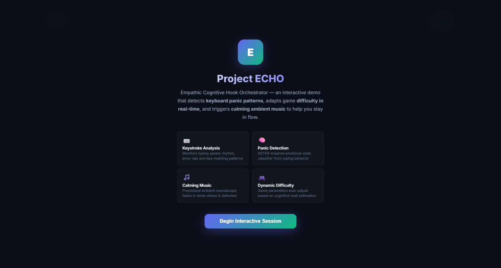
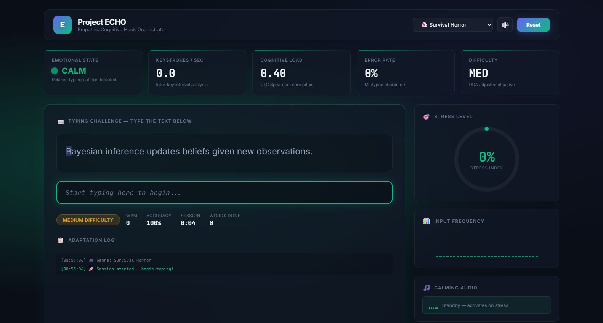
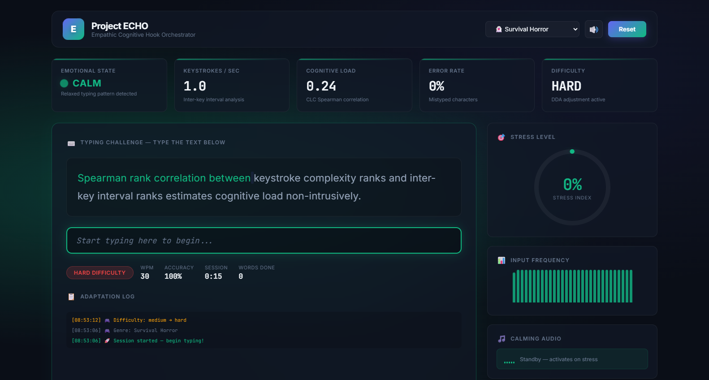
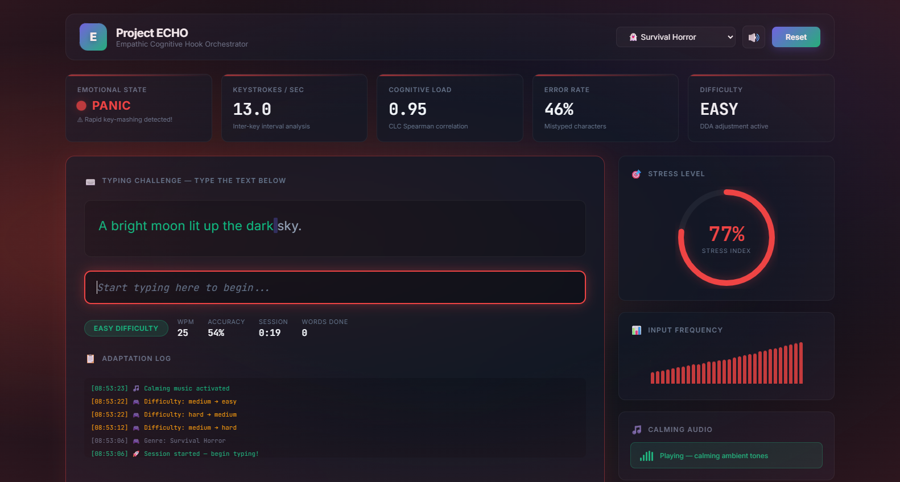
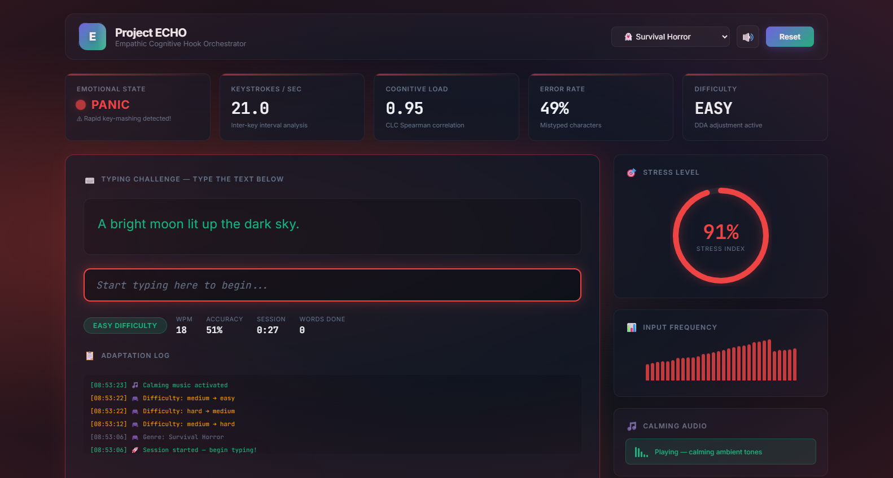
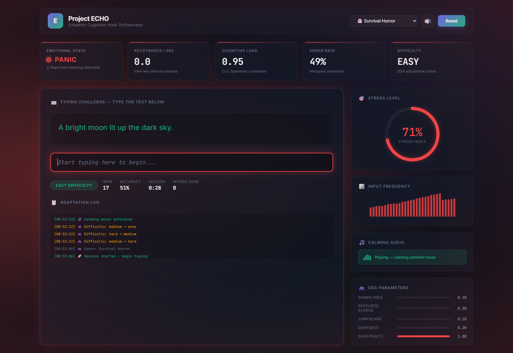
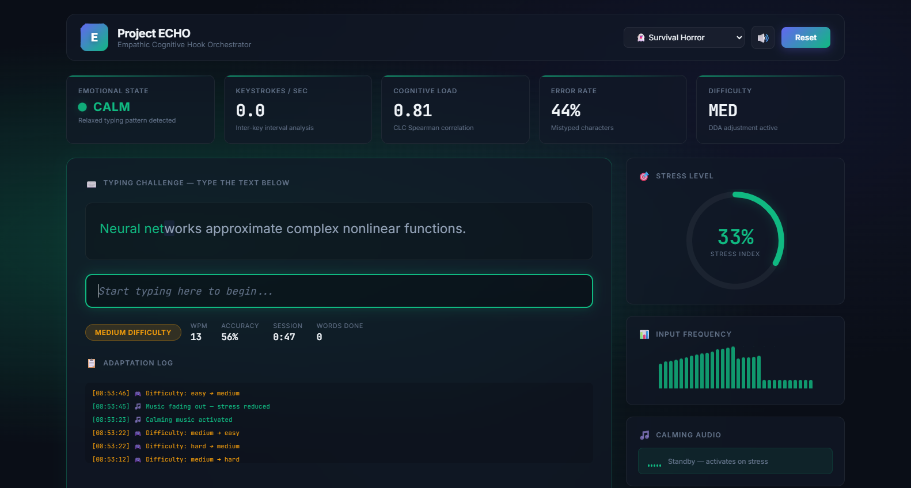
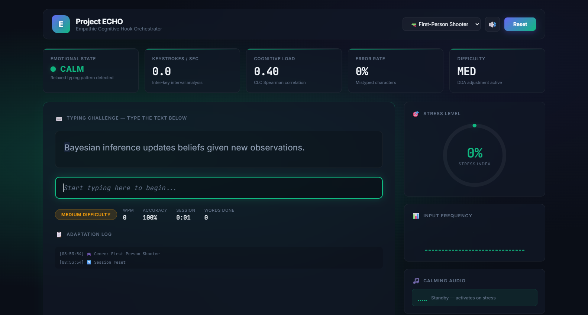
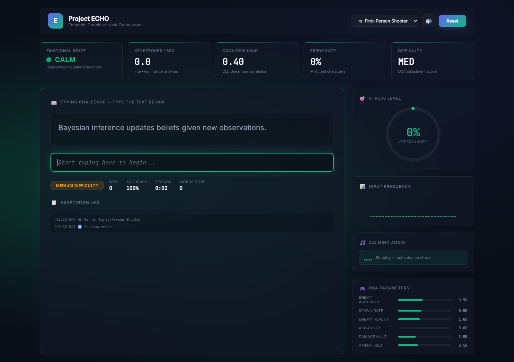

# Project ECHO — UI Portal Screenshots

Screenshots of the interactive demo ([`echo_interactive_demo.html`](../echo_interactive_demo.html)).
I captured them at 1600×1000 in headless Chrome. The script sent synthetic keystrokes to push the UI through each emotional state.

| # | Screen | What it shows |
|---|--------|---------------|
| 1 | Welcome | Landing overlay with the four core capabilities |
| 2 | Dashboard (idle) | Live metrics strip, typing challenge, stress gauge, audio panel |
| 3 | Steady typing | CALM state, 100% accuracy, DDA raises difficulty → **HARD** |
| 4 | Panic onset | Key-mashing detected, stress 77%, calming music starts |
| 5 | Panic peak | Stress 91%, cognitive load 0.95, DDA eases → **EASY** |
| 6 | Panic (full page) | Whole layout in the red panic theme |
| 7 | Recovery | Back to CALM (33%), music on standby, difficulty → MED |
| 8 | Genre switch | First-Person Shooter profile loaded |
| 9 | Full dashboard | Full page, including the DDA parameter panel |

## 1. Welcome Screen

## 2. Dashboard — Idle / Calm

## 3. Steady Typing — Difficulty Raised

## 4. Panic Onset

## 5. Panic Peak

## 6. Panic — Full Page

## 7. Recovery — Calming

## 8. Genre Switch — FPS Profile

## 9. Full Dashboard with DDA Parameters

